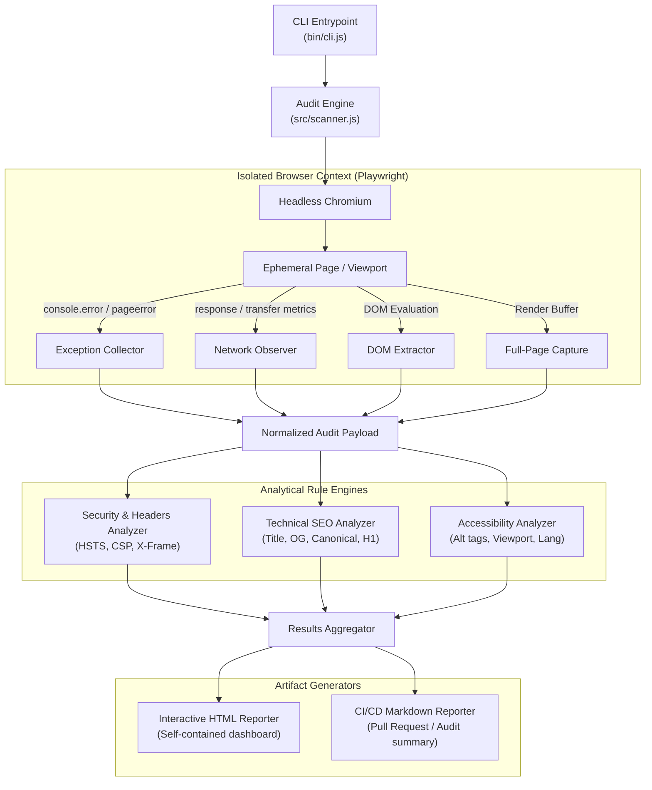

# web-audit-cli

> High-throughput, headless browser automation CLI for auditing web application telemetry, HTTP security headers, runtime exceptions, and DOM integrity.

[](https://nodejs.org/)
[](https://playwright.dev/)
[](https://owasp.org/)
[](tests/)
[](LICENSE)

---

## Overview

Modern web applications rely heavily on client-side execution, asynchronous network waterfalls, and third-party scripts. Traditional static scanners (such as `curl` or Cheerio-based scrapers) fail to detect errors emitted after hydration, DOM mutations, or runtime exceptions.

`web-audit-cli` solves this by orchestrating an ephemeral **Chromium** instance through **Playwright**. It observes network traffic at the protocol layer, intercepts uncaught JavaScript exceptions, evaluates on-page DOM compliance, inspects HTTP transport hardening headers, and serializes actionable diagnostic reports in both standalone interactive HTML and GitHub-flavored Markdown.

---

## Architecture

The following diagram illustrates the execution lifecycle, event observers, and reporting pipelines:



---

## Engineering Design Decisions

| Decision | Selection | Rationale |
| :--- | :--- | :--- |
| **Execution Engine** | Playwright (Headless Chromium) | Emulates true browser hydration and evaluates JavaScript execution. Enables capturing unhandled client-side runtime errors (`window.onerror`), observing deferred network requests, and taking pixel-accurate full-page layout screenshots. |
| **Context Isolation** | Ephemeral Browser Contexts | Each audit runs inside a newly spawned context with a fixed viewport (`1280x800`) and standard desktop User-Agent, preventing cache leakage, cookie contamination, or residual state between consecutive runs. |
| **Decoupled Architecture** | Data / Rules / Reporters Separation | Analysis routines (`src/analyzers/`) operate purely on normalized plain objects (`domData` and HTTP headers). This guarantees zero coupling to browser primitives, allowing rule logic to be tested independently in sub-millisecond unit tests. |
| **Zero Heavy Dependencies** | Native Node.js Test Runner (`node:test`) | Kept the project lean by eliminating bulky testing frameworks (e.g. Jest or Mocha) in favor of Node's built-in test runner, keeping dependency bloat to a minimum while ensuring native ESM/CJS compatibility. |

---

## Audited Surface

1. **Security & Transport Hardening:**
   - Transport encryption verification (`TLS / HTTPS`).
   - `Strict-Transport-Security` (HSTS) presence and enforcement.
   - `X-Frame-Options` validation to prevent Clickjacking.
   - `Content-Security-Policy` (CSP) verification to mitigate Cross-Site Scripting (XSS).

2. **Network & Runtime Diagnostics:**
   - Full HTTP status tracking (detecting 4xx / 5xx anomalies across all assets).
   - Payload volume computation (`totalTransferredBytes`) and breakdown by resource type (`fetch`, `script`, `stylesheet`, `image`, `font`).
   - Passive listener for uncaught browser console exceptions and runtime errors.

3. **DOM & Technical SEO Health:**
   - Meta title, description length thresholds, single `<h1>` hierarchy enforcement.
   - OpenGraph metadata (`og:title`, `og:image`) and canonical link declarations.
   - Core accessibility checks: Image `alt` attribute coverage, viewport configuration, and document `lang` specification.

---

## Quickstart

### Prerequisites
- Node.js `>= 18.0.0`
- npm or pnpm

### Installation

```bash
# Clone the repository
git clone https://github.com/mariaalopez4/web-audit-cli.git
cd web-audit-cli

# Install dependencies and install Chromium binary
npm install
npx playwright install chromium
```

### Usage

Run an audit against any target URL:

```bash
# Audit a live website
node bin/cli.js https://example.com

# Audit with a custom navigation timeout (in milliseconds)
node bin/cli.js https://news.ycombinator.com --timeout 15000
```

### CLI Output Example

```text
[web-audit] Auditing https://example.com (timeout: 30000ms)...
[web-audit] Completed in 1.42s
--------------------------------------------------
Status:       200
Checks:       9 passed, 3 warnings, 0 failed
Transferred:  128.4 KB (14 requests)
Exceptions:   0 (0 console, 0 network)
--------------------------------------------------
HTML Report:  file:///c:/Users/User/web-audit-cli/report.html
Markdown:     c:\Users\User\web-audit-cli\report.md
Session Dir:  c:\Users\User\web-audit-cli\reports\example.com_2026-10-30T10-15-22
```

---

## Project Structure

```text
web-audit-cli/
├── bin/
│   └── cli.js                     # CLI executable entry point & option parsing
├── src/
│   ├── analyzers/
│   │   ├── accessibility.js       # WCAG/A11y DOM validation rules
│   │   ├── security.js            # HTTP response headers & transport checks
│   │   └── seo.js                 # Technical SEO and metadata inspection
│   ├── reporters/
│   │   ├── htmlReporter.js        # Self-contained HTML interactive report template
│   │   └── markdownReporter.js    # Markdown table generator for CI/CD pipelines
│   └── scanner.js                 # Core orchestrator: browser lifecycle & event hooks
├── tests/
│   └── analyzers.test.js          # Unit tests covering analytical rule engines
├── .gitignore                     # Git exclusion rules (ignores reports, screenshots)
├── LICENSE                        # MIT License
├── package.json                   # Project metadata and dependencies
└── README.md                      # Technical documentation & case study
```

---

## Testing

Execute the native unit test suite:

```bash
npm test
```

The test suite validates edge cases across security header evaluation, malformed DOM structures, and accessibility fallbacks with sub-millisecond execution times.

---

## Author

**María López Padilla**  
- GitHub: [@mariaalopez4](https://github.com/mariaalopez4)  
- LinkedIn: [linkedin.com/in/marialopezpadilla](https://www.linkedin.com/in/marialopezpadilla/)  
- Portfolio: [mariaalopez4.github.io](https://mariaalopez4.github.io)

---

## License

This project is licensed under the [MIT License](LICENSE).
