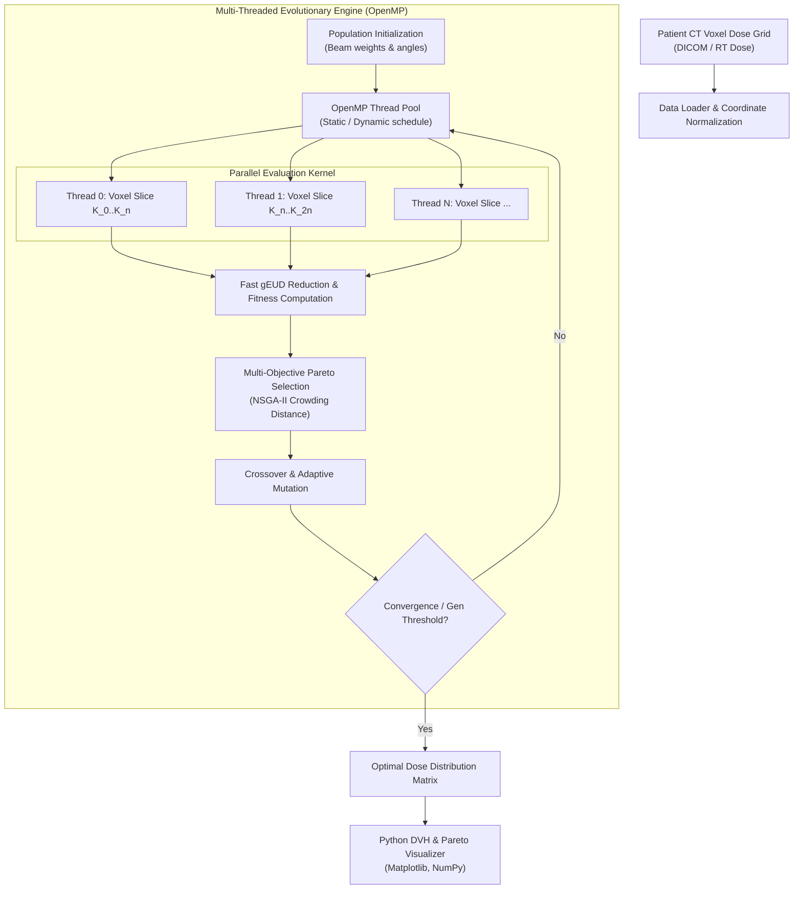

# geud-hpc-optimizer

> High-Performance Computing (HPC) acceleration and evolutionary multi-objective optimization of generalized Equivalent Uniform Dose (gEUD) models for Intensity-Modulated Radiation Therapy (IMRT) planning.

[](https://isocpp.org/)
[](https://www.openmp.org/)
[](https://python.org/)
[](#)
[](#)

---

## Overview

Radiation therapy optimization in Intensity-Modulated Radiation Therapy (IMRT) requires calculating non-linear physical dose distributions while simultaneously sparing critical Organs at Risk (OARs) and maximizing Planning Target Volume (PTV) coverage.

Evaluating the generalized Equivalent Uniform Dose (gEUD) across voxel grids of millions of coordinates is computationally intensive. Traditional sequential optimizers suffer from prohibitive latency, making fine-grained Pareto exploration infeasible during clinical planning windows.

`geud-hpc-optimizer` introduces a multi-core parallelized evolutionary optimization architecture implemented in C++ and OpenMP, accelerating gEUD evaluations and automating non-dominated Pareto frontier discovery for personalized patient treatment plans.

---

## Architecture & Parallel Pipeline



---

## Design Decisions & HPC Profiling

| Component | Technical Choice | Engineering Rationale |
| :--- | :--- | :--- |
| **Language** | C++17 | Direct memory alignment, cache-line efficiency, and zero garbage-collection jitter during deep loop iterations. |
| **Parallel Paradigm** | OpenMP Multi-Core | Exploits shared memory architectures on medical planning workstations without the distributed network overhead of MPI. |
| **Loop Vectorization** | `#pragma omp simd` + AVX2 | Vectorizes exponentiation calculations in the continuous gEUD formulation over contiguous voxel memory. |
| **Validation Layer** | Python (`NumPy`, `SciPy`) | Independent regression testing harness comparing parallel evaluation outputs against clinical ground-truth planning benchmarks. |

---

## Quickstart

### Prerequisites
- GCC / Clang with OpenMP support (`g++ >= 9.0`)
- CMake `>= 3.16`
- Python `>= 3.9`

### Build

```bash
mkdir build && cd build
cmake -DCMAKE_BUILD_TYPE=Release ..
make -j$(nproc)
```

### Run Benchmark

```bash
# Execute optimization using 8 parallel worker threads
./geud_optimizer --case patient_01.dat --threads 8 --generations 500 --pop 100
```

---

## Scientific Publication & Academic Distinction

- **Distinction:** BSc Thesis awarded **Matrícula de Honor** and **Premio Extraordinario de Fin de Estudios** (Universidad de Almería).
- **Publication:** Co-author of peer-reviewed scientific paper on radiotherapy optimization through high-performance computing (2024).

---

## Author

**María López Padilla** — [GitHub](https://github.com/mariaalopez4) • [LinkedIn](https://www.linkedin.com/in/marialopezpadilla/)
