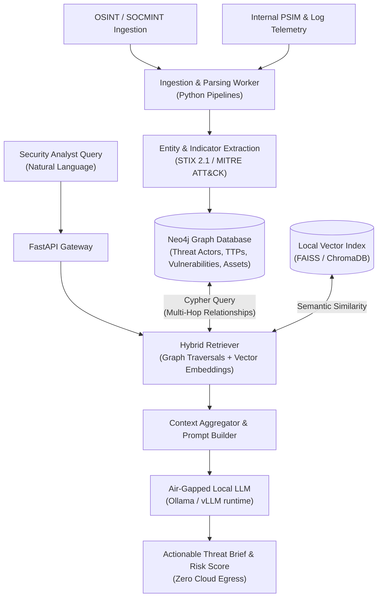

# threat-graph-rag

> Sovereign, Graph-Driven Threat Intelligence & Local RAG Architecture for Enterprise Incident Correlation and Automated Risk Modeling.

[](https://python.org/)
[](https://neo4j.com/)
[](https://ollama.ai/)
[](https://fastapi.tiangolo.com/)
[](LICENSE)

---

## Overview

Modern Cyber Threat Intelligence (CTI) platforms frequently ingest voluminous, unstructured data feeds (OSINT, SOCMINT, CVE advisories, and internal sensor logs). Analyzing relationships between threat actors, malware campaigns, enterprise assets, and exploited vulnerabilities requires non-relational graph traversal.

Simultaneously, leveraging cloud-based Large Language Models introduces severe data-exfiltration risks when analyzing proprietary or classified security events.

`threat-graph-rag` solves this duality by uniting a **Neo4j Property Graph** with an air-gapped **Local RAG Pipeline**, allowing analysts to perform natural language inquiries translated into Cypher queries, correlate multi-hop attack paths, and generate risk assessments with **100% data sovereignty**.

---

## Architecture



---

## Key Capabilities

1. **Graph-Modeled Threat Topography:** Models security entities using standardized ontology (threat actors, malware families, CVEs, target sector, internal infrastructure nodes) in Neo4j.
2. **Sovereign Local Inference:** Employs quantized open-weights models running completely on-premises to guarantee data privacy.
3. **Multi-Hop Traversal:** Uncovers hidden relationships (e.g. indirect supply-chain compromises or reused infrastructure) invisible to traditional tabular SIEMs.
4. **Automated Risk Scoring:** Evaluates intent, capability, and target opportunity to calculate probabilistic risk indices.

---

## Quickstart

### Environment Setup

```bash
# Clone the repository
git clone https://github.com/mariaalopez4/threat-graph-rag.git
cd threat-graph-rag

# Setup Python environment
python -m venv .venv
source .venv/bin/activate  # On Windows: .venv\Scripts\activate
pip install -r requirements.txt

# Start local infrastructure
docker compose up -d neo4j ollama
```

### Run Server

```bash
uvicorn app.main:app --host 0.0.0.0 --port 8000 --reload
```

---

## Author

**María López Padilla**  
Physical Security & Intelligence Analyst @ Banco de España  
[GitHub](https://github.com/mariaalopez4) • [LinkedIn](https://www.linkedin.com/in/marialopezpadilla/) • [Portfolio](https://mariaalopez4.github.io)
